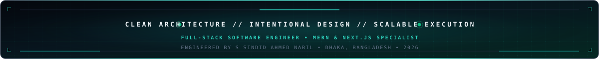

<!-- ============================================================== -->
<!--                      HEADER & HERO BANNER                      -->
<!-- ============================================================== -->

<div align="center">
  

  <p align="center">
    <code>LOCATION: DHAKA, BD [23.8103° N, 90.4125° E]</code>
    &nbsp;&bull;&nbsp;
    <code>STACK: MERN / NEXT.JS / DISTRIBUTED APIs</code>
    &nbsp;&bull;&nbsp;
    <code>STATUS: AVAILABLE</code>
  </p>

  <!-- High-legibility, single-line typewriter animation -->
  <a href="https://github.com/nabilpwqz">
    
  </a>

  <!-- High-contrast, reliable social & telemetry badges -->
  <p align="center">
    <a href="https://github.com/nabilpwqz">
      
    </a>
    &nbsp;
    <a href="https://www.linkedin.com/in/nabilpwqz">
      
    </a>
    &nbsp;
    <a href="mailto:nabilpwqz@gmail.com">
      
    </a>
    &nbsp;
    
  </p>
</div>

---

<!-- ============================================================== -->
<!--                  01 // PROFILE & PHILOSOPHY                   -->
<!-- ============================================================== -->

## 01 // Profile & Core Philosophy

```typescript
interface FullStackEngineer {
  readonly identity: "S Sindid Ahmed Nabil";
  readonly location: "Dhaka, Bangladesh [23.8103° N, 90.4125° E]";
  readonly discipline: "Full-Stack Software Engineering";
  readonly specialization: ["MERN Architecture", "Next.js Full-Stack", "Scalable REST/GraphQL APIs"];
  readonly secondaryAdvantage: "5+ Years Brand Identity & Visual Design Systems";
  readonly coreValues: ["Clean Code", "Defensive Architecture", "Performance Optimization", "High UX Fidelity"];
  readonly status: "Available for Software Engineering Roles & High-Impact Collaborations";
}

const SoftwareEngineer: FullStackEngineer = {
  identity: "S Sindid Ahmed Nabil",
  location: "Dhaka, Bangladesh [23.8103° N, 90.4125° E]",
  discipline: "Full-Stack Software Engineering",
  specialization: ["MERN Architecture", "Next.js Full-Stack", "Scalable REST/GraphQL APIs"],
  secondaryAdvantage: "5+ Years Brand Identity & Visual Design Systems",
  coreValues: ["Clean Code", "Defensive Architecture", "Performance Optimization", "High UX Fidelity"],
  status: "Available for Software Engineering Roles & High-Impact Collaborations"
};
```

<br/>

<div align="center">
  <table>
    <tr>
      <td width="55%" valign="top">
        <h4 align="left">Engineering Background</h4>
        <p align="left">
          I am a <strong>Full-Stack Software Engineer</strong> focused on developing robust, fault-tolerant web applications. With an emphasis on modern JavaScript/TypeScript ecosystems, I build end-to-end architectures that unite efficient server-side logic with responsive, accessible user interfaces.
        </p>
        <p align="left">
          My development approach prioritizes modular codebases, optimized database queries, secure authentication flows, and maintainable state management across distributed components.
        </p>
      </td>
      <td width="45%" valign="top">
        <h4 align="left">Active Research &amp; Focus Areas</h4>
        <ul align="left">
          <li><strong>Modern Full-Stack:</strong> Next.js App Router, Server Actions, SSR/SSG caching strategies</li>
          <li><strong>Distributed Systems:</strong> Microservices boundaries, event-driven pipelines, message queues</li>
          <li><strong>Real-Time Systems:</strong> WebSockets, state synchronization, Redis pub/sub</li>
          <li><strong>Database Optimization:</strong> Indexing strategies, aggregation pipelines, schema normalization</li>
        </ul>
      </td>
    </tr>
  </table>
</div>

---

<!-- ============================================================== -->
<!--             02 // DUAL COMPETENCY: CODE + DESIGN               -->
<!-- ============================================================== -->

## 02 // Engineering & Design Convergence

A common friction point in product development is the communication barrier between engineering constraints and design intent. My background synthesizes 5+ years of graphic design and brand identity with rigorous full-stack development.

<div align="center">
  
</div>

- **Rapid Prototyping to Production:** Seamless transition from Figma concepts to semantic, accessible React/Next.js components.
- **Consistent Design Systems:** Strict token-driven design rules that reduce UI debt and maintain brand cohesion across platforms.
- **User-Centric Performance:** Balanced aesthetic fidelity with low Time to First Byte (TTFB) and high Core Web Vitals scores.

---

<!-- ============================================================== -->
<!--                   03 // TECHNICAL STACK                        -->
<!-- ============================================================== -->

## 03 // Technical Competencies

<div align="center">

<h4>Languages &amp; Frameworks</h4>
<p>
  
</p>

<h4>Backend Engineering &amp; APIs</h4>
<p>
  
</p>

<h4>Databases &amp; Data Storage</h4>
<p>
  
</p>

<h4>Cloud, DevOps &amp; Tooling</h4>
<p>
  
</p>

<h4>Creative Suite &amp; UI Design</h4>
<p>
  
</p>

</div>

---

<!-- ============================================================== -->
<!--                04 // PROJECT HIGHLIGHTS & ARCHITECTURE         -->
<!-- ============================================================== -->

## 04 // Architecture Highlights & Case Studies

<div align="center">

| Project / Domain | Architecture &amp; Role | Technology Stack | Key Engineering Deliverables |
| :--- | :--- | :--- | :--- |
| **Tourism Platform** | Full-Stack Architect | Next.js, Node.js, MongoDB, Tailwind | Dynamic booking engine, geo-indexed search, server-side rendered routes, automated confirmation pipelines |
| **E-Commerce Engine** | Backend &amp; UI Developer | React, Node.js, Express, Stripe, Redux | JWT authentication, atomic checkout flow, webhook-driven order states, administrative analytics dashboard |
| **Real-Time Workspace** | Full-Stack Developer | React, Express, WebSockets, Tailwind | Low-latency bi-directional messaging, live user presence tracking, role-based authorization |
| **Brand Identity Systems** | Visual Designer &amp; Director | Figma, Illustrator, Photoshop | Comprehensive identity guidelines, vector mark design, scalable digital asset libraries for 50+ clients |

</div>

---

<!-- ============================================================== -->
<!--                  05 // GITHUB ANALYTICS                        -->
<!-- ============================================================== -->

## 05 // Live GitHub Analytics

<div align="center">
  <table border="0">
    <tr>
      <td align="center" width="50%">
        
      </td>
      <td align="center" width="50%">
        
      </td>
    </tr>
    <tr>
      <td colspan="2" align="center">
        
      </td>
    </tr>
  </table>
</div>

---

<!-- ============================================================== -->
<!--                   06 // CONTACT & ENGAGEMENT                   -->
<!-- ============================================================== -->

## 06 // Connect & Professional Inquiries

Open to conversations regarding full-stack software engineering positions, architectural consulting, and technical collaborations.

<div align="center">

<p align="center">
  <a href="https://www.linkedin.com/in/nabilpwqz">
    
  </a>
  &nbsp;
  <a href="https://github.com/nabilpwqz">
    
  </a>
  &nbsp;
  <a href="mailto:nabilpwqz@gmail.com">
    
  </a>
</p>

<br/>

| Channel | Direct Access / Handle | Availability &amp; Purpose |
| :--- | :--- | :--- |
| **LinkedIn** | [linkedin.com/in/nabilpwqz](https://www.linkedin.com/in/nabilpwqz) | Engineering roles, leadership inquiries, professional network |
| **GitHub** | [github.com/nabilpwqz](https://github.com/nabilpwqz) | Open-source contributions, code reviews, architectural repositories |
| **Direct Email** | [nabilpwqz@gmail.com](mailto:nabilpwqz@gmail.com) | Direct dispatch, consulting engagements, high-priority discussions |

<br/>

```
"Clean architecture. Intentional design. Scalable execution."
```



</div>
